# Pi Server Suite

Everything you need to run a Raspberry Pi 5 or Pi 500 as a home server, in one place.
**Server Room** is the hub: a **Running servers** bar at the top shows every web server on the Pi
(and whether other devices can reach it) with a **Stop** button for each, plus a light for every
suite app and a plain-English **Server check-up** that tells you what to fix first.

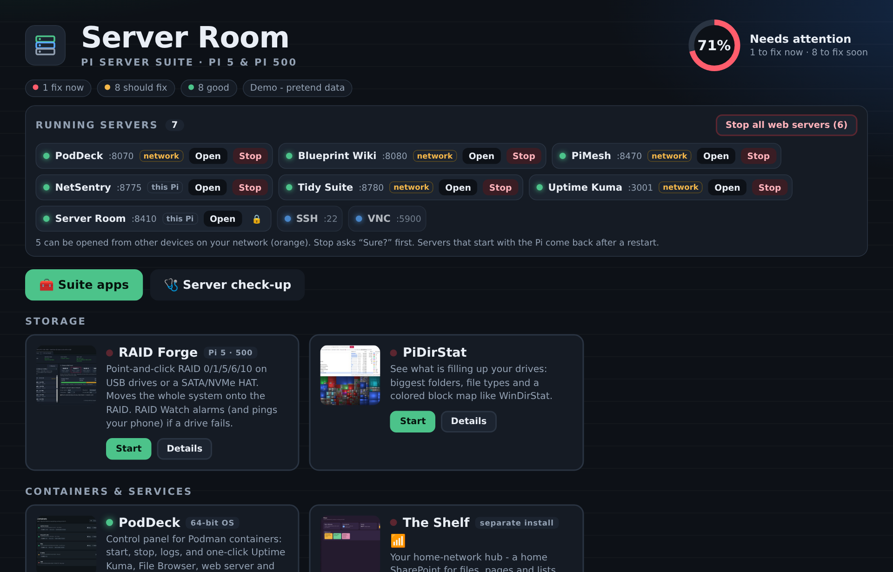

## The apps

| | App | What it does |
|---|---|---|
| 🩺 | **Server Room** | The hub. Server check-up (about 20 checks) plus Open/Start for every app below. Port 8410, this Pi only. |
| 💽 | **RAID Forge** + RAID Watch | Point-and-click RAID 0/1/5/6/10 on USB drives or a SATA/NVMe HAT, move the system onto the RAID, and get an alarm (and a phone push) if a drive fails. |
| 📊 | **PiDirStat** | See what's filling your drives, WinDirStat-style. |
| 📦 | **PodDeck** | Control panel for Podman containers, with one-click Uptime Kuma, File Browser and more. Port 8070. |
| 🛡️ | **NetSentry** | Live list of every device on your network, with warnings about anything suspicious. |
| 📈 | **NetPulse** | Up/down board for your devices (import IPs from Excel) and ping-over-time graphs. |
| 🔌 | **WiFi Share** | Share the Pi's Wi-Fi out of its Ethernet port. |
| 🕸️ | **PiMesh** | Links all your Pis into one live dashboard. Port 8470. |
| 🧮 | **RPi500+ Task Manager** | Windows-style Task Manager, phone web page and an "Update everything" button. |
| 📘 | **Blueprint Wiki** | Document your server: pages, checklists, PDFs, network maps. |
| 🔐 | **Latch** | Offline password safe for your server, router and container passwords. |
| 🚀 | **PiStartup** | Everything that starts with the Pi, with boot times; switch off what a server doesn't need. |
| ⚡ | **VNC Turbo** | Makes remote desktop fast again: finds the cause and fixes it with one click, all undoable. |
| 🌀 | **Pironman Pilot** | Only on a Pi 5 in a SunFounder Pironman 5 MAX case: OLED, quiet fan curves, side-fan speed control, lights, safe overclocking. |
| 🗂️ | **Tidy Suite** | Hosts the whole Tidy Suite for everyone on your Wi-Fi (port 8780); each person's work is saved on the Pi. |
| 🎙️ | **Pip** | Offline voice assistant for a headset - no internet needed. |
| ✂️ | **PiSnip** | Snipping Tool: screenshots, markup and screen recording. |
| 🗄️ | **The Shelf** | Home-network hub (installs separately: [the-shelf](https://github.com/hardwaremack-prog/the-shelf)). |

## Screenshots

### Running servers
Every web server on the Pi, with **network** (orange: phones and PCs can open it) or **this Pi**. Stop asks "Sure?" first and warns about anything important.

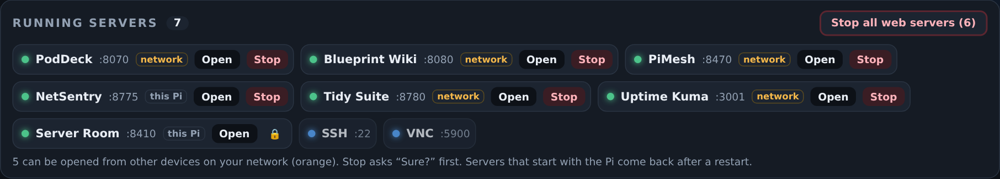
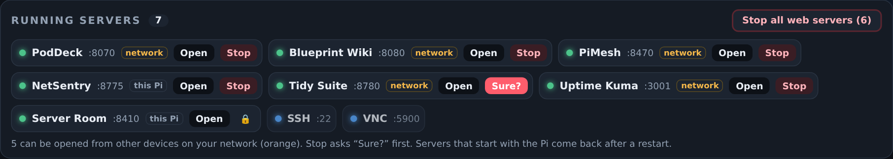

### Server check-up
Only the things to fix, worst first, each with what it means and a command to copy.

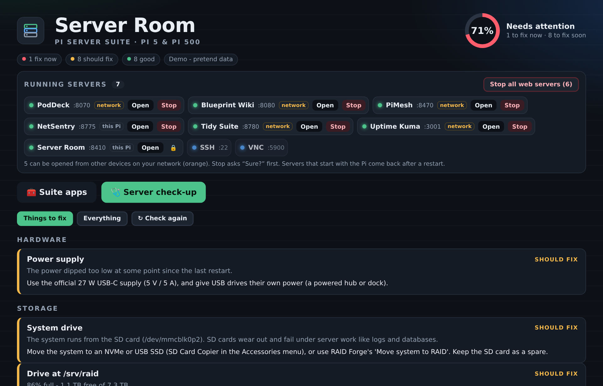

<details><summary>Every check</summary>

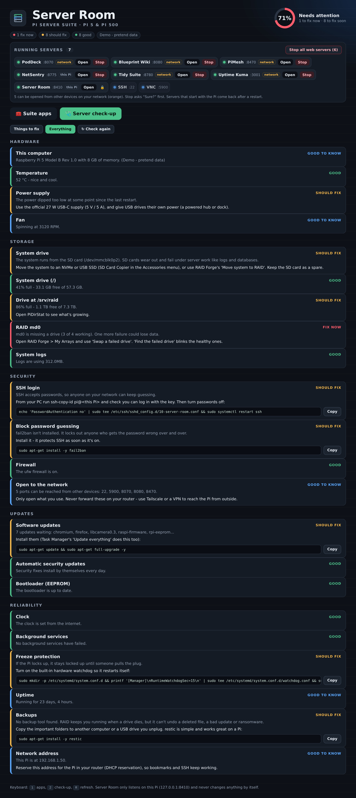
</details>

### On your phone
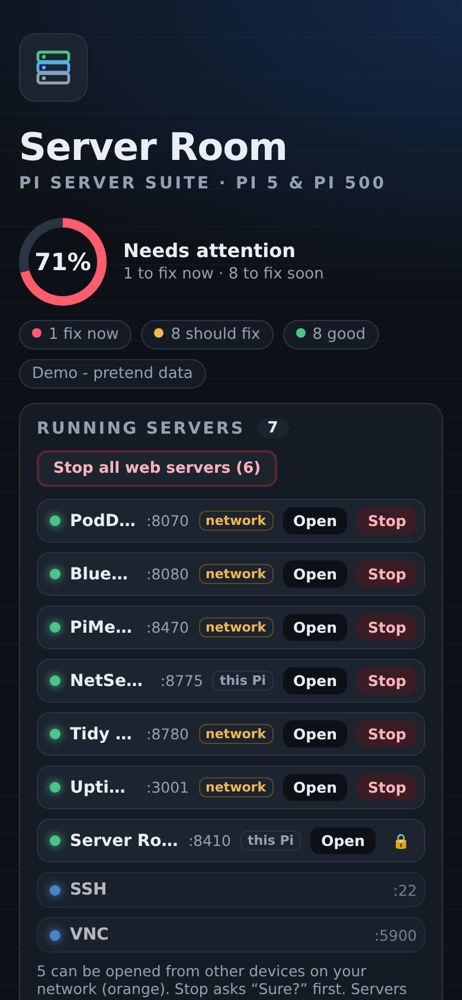

### In My Apps (Server Suite tab)
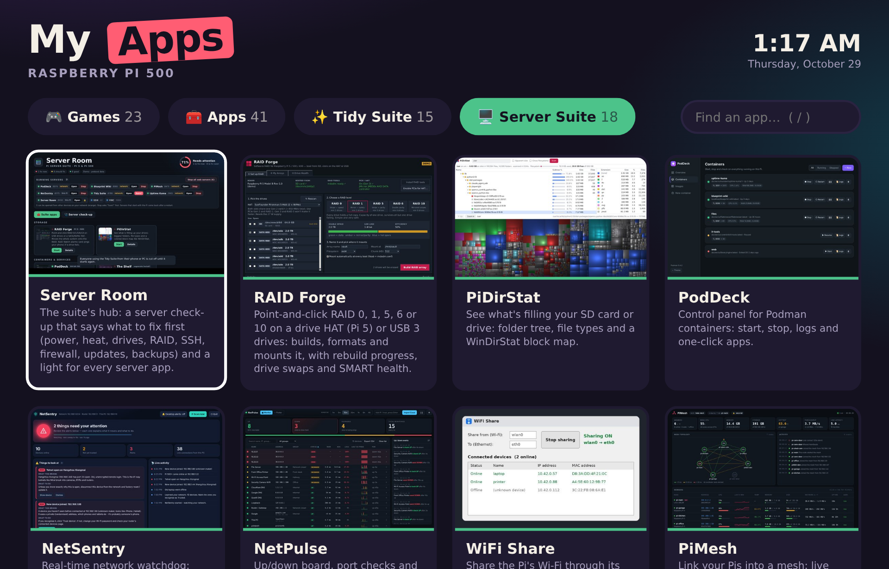

### Tidy Suite, hosted by the Pi
Everyone on the Wi-Fi opens `http://<the Pi>:8780`; the green dot by their name means their work is saved on the Pi.

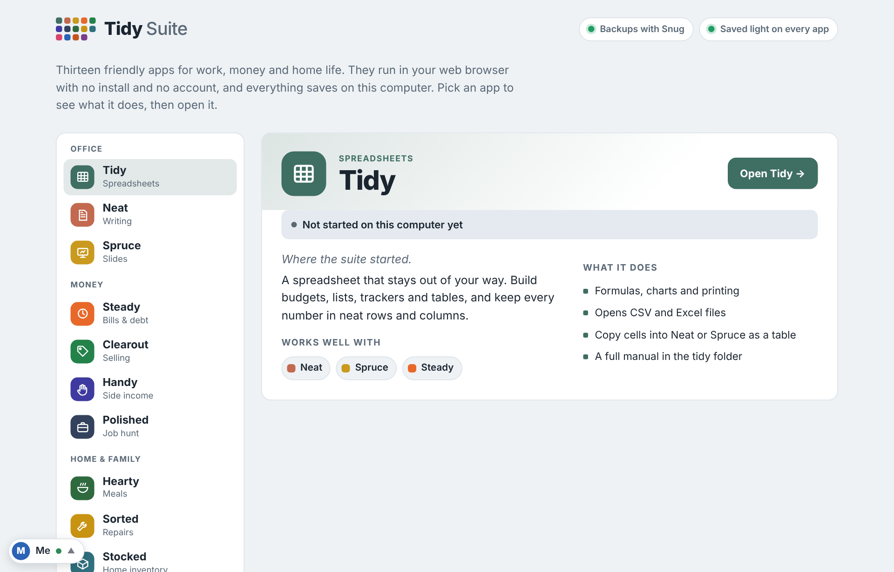

### Pironman Pilot (Pironman 5 MAX case)
| | |
|---|---|
| 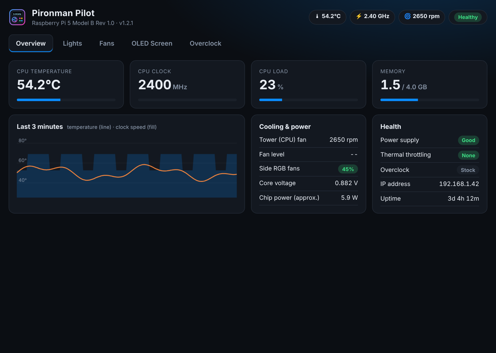 | 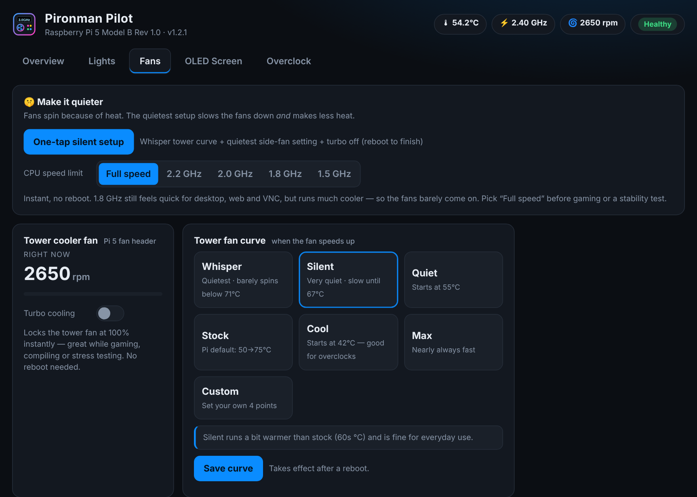 |
|  |  |
| 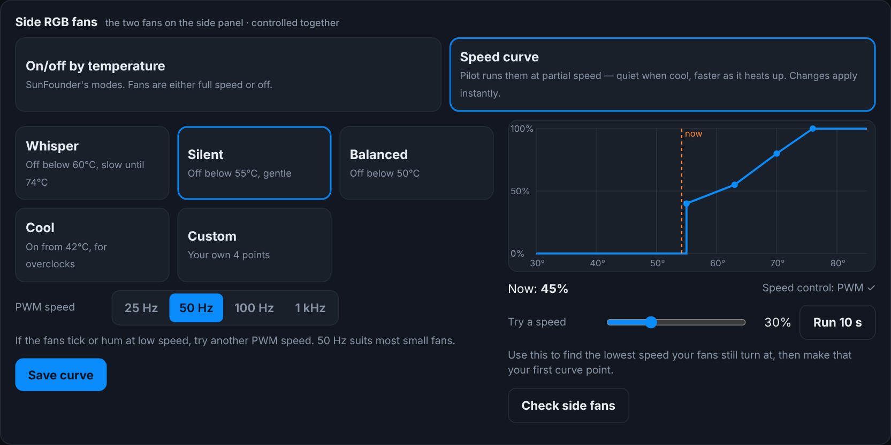 | 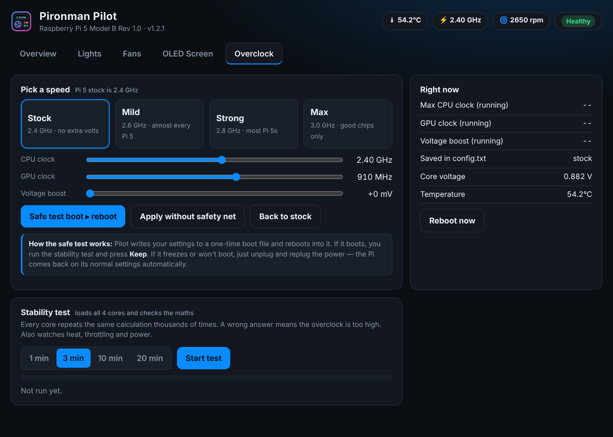 |

### VNC Turbo and PiStartup
| VNC Turbo | PiStartup |
|---|---|
|  | 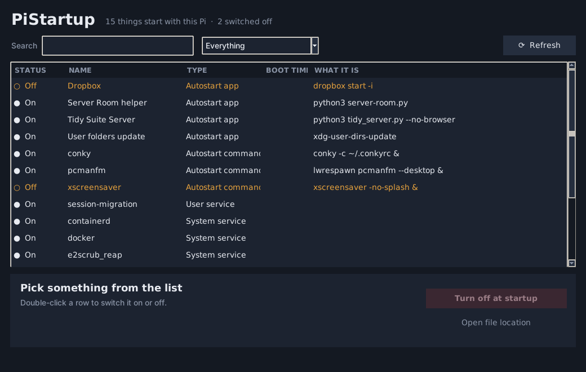 |

The screenshots use Server Room's demo mode and sample readings (`python3 server-suite/server-room.py --demo --open`).

## What the check-up looks at

- **Hardware**: temperature, power supply dips and throttling, USB power for drives, fan
- **Storage**: running from the SD card (it wears out), disk space on every drive, RAID health and rebuilds, log size
- **Security**: SSH password logins and root login, fail2ban, firewall, what's open to the network, sudo without a password
- **Updates**: waiting updates (and how many are security fixes), automatic security updates, restart needed, bootloader (EEPROM)
- **Reliability**: clock sync, failed services (switch off what you don't need in PiStartup), freeze protection (hardware watchdog), backups, a fixed address for the Pi

Each problem says what it means and gives a command you can copy. Server Room never changes anything by itself.

## Install

On the Pi, open a Terminal in this folder and run:

```bash
bash "Install Pi Server Suite.sh"   (or double-click it)
```

It adds a **Server Room** icon to the Desktop and menu, starts the hub with the Pi, then asks about each app.
Already using My Apps? `Set Up My Apps.sh` installs Server Room for you, and the suite has its own **Server Suite** tab.

Just want to look? `python3 server-suite/server-room.py --demo --open` runs it with pretend data on any computer.

## Needs

- Raspberry Pi 5 or Pi 500 (most of it works on a Pi 4)
- Raspberry Pi OS Bookworm or newer; PodDeck needs the 64-bit version
- Python 3 (already on Raspberry Pi OS). Server Room uses only the standard library.
